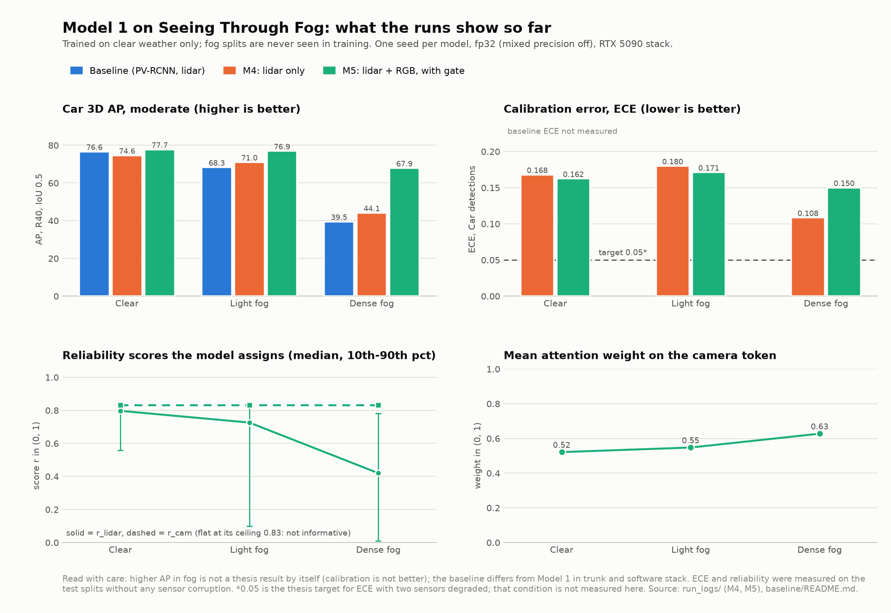
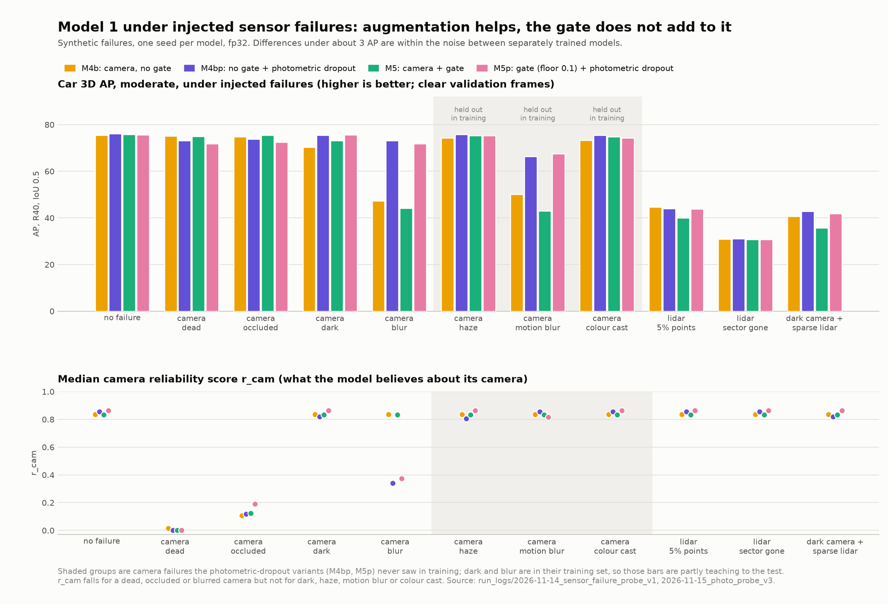

# Model 1: reliability-gated multimodal transformer

Fuses lidar (HDL-64 strongest) and the left RGB camera. Attention over modality
tokens is modulated by a learned per-stream reliability score. Built on OpenPCDet
as plug-in modules; OpenPCDet source and `../../baseline/` are not modified.

Full design and metric definitions: `docs/DESIGN.md`.

## Status

| Milestone | Work | Status |
| --- | --- | --- |
| M0 | Folder scaffold, README, DESIGN.md | done |
| M1 | Camera data: extract, demosaic, rectify and tone-map left-camera images for all 7,829 split frames; verify | done (`sarvesh/model1-data`): 7,829/7,829 images; alignment median (0, 0) px; all checks pass |
| M2 | Docker image, dataset config, model code, tools, tests | done, merged (`model1/integrate`). Re-verified 2026-11-13 on an RTX 5090: image rebuilt for sm_120, 20 / 20 tests pass |
| M1b | Real images rebuilt on the 5090 box from the raw `cam_stereo_left` archive; Docker volume and infos built | done 2026-11-13: 7,829 / 7,829 PNGs, `03_verify_images.py` ALL CHECKS PASSED, median shift (0, 0) px (`docs/RUN_LOG.md`) |
| M3 | 200-frame slice: overfit test + epoch timing | done 2026-11-13. The committed config (`USE_AMP: True`) goes NaN; with `USE_AMP: False` training is finite. One epoch = 4 min 51 s. fp16-safe fix not applied: M4/M5 ran in fp32, a recorded deviation (`docs/RUN_LOG.md`) |
| M4 | Lidar-only ablation, full training | done 2026-11-14 (one seed, fp32): moderate AP 74.57 / 70.97 / 44.09 (clear / light / dense fog) |
| M5 | Full Model 1: train, best-on-val, three test splits; AP + ECE + D-ECE + reliability | done 2026-11-14 as a first run (one seed, fp32): 77.70 / 76.89 / 67.85; ECE 0.162 / 0.171 / 0.150 |
| M4b | Ablation: camera without the reliability gate (`configs/model1_lidar_rgb_nogate.yaml`) | done 2026-11-14 (one seed, fp32): 77.55 / 76.32 / 68.29, ECE 0.153 / 0.159 / 0.137: the same AP as M5, so the gate adds nothing measurable |
| M5p / M4bp | Variants with generic photometric camera dropout (dark, blur); M5p = gate with floor 0.1, M4bp = no-gate control (`configs/model1_lidar_rgb_photo.yaml`, `..._nogate_photo.yaml`) | done, **3 seeds each** (2026-11-14 to 16, fp32). A blurred camera now costs about 3 AP instead of about 30, but the ungated control does the same. The seed-666 gate-vs-no-gate AP gap (+1-2 AP) does **not** survive a second or third seed (seed 111: dense fog flips sign to -0.91) and is smaller than M4bp's own run-to-run variance: no reproducible gate advantage |
| M6 | Writeup against the baseline | todo, after the baseline gate passes |

## Results so far



Regenerate with `tools/make_results_figure.py` (reads the archived run logs). Moderate Car 3D AP (R40, IoU 0.5) and
ECE on the three STF test splits; one seed per model, fp32:

| Split | Baseline AP | M4 no camera AP | M4b camera, no gate AP | M5 camera + gate AP | Baseline ECE | M4 ECE | M4b ECE | M5 ECE |
| --- | --- | --- | --- | --- | --- | --- | --- | --- |
| Clear | 76.59 | 74.57 | 77.55 | 77.70 | 0.182 | 0.168 | 0.153 | 0.162 |
| Light fog | 68.26 | 70.97 | 76.32 | 76.89 | 0.200 | 0.180 | 0.159 | 0.171 |
| Dense fog | 39.49 | 44.09 | 68.29 | 67.85 | 0.263 | 0.108 | 0.137 | 0.150 |

What this does and does not show (details and caveats in `docs/RUN_LOG.md`):

- **The camera accounts for the fog gain, not the gate.** The chain M4 (no camera) -> M4b (camera, no gate) -> M5
  (camera + gate) uses the same trunk, head, schedule and seed. Adding the camera is worth +3 AP in clear weather, +5 in
  light fog and +24 in dense fog; adding the reliability gate on top changes AP by +0.15, +0.57 and -0.44, which is
  within what one seed can move. The camera-off model behaves like the baseline in fog.
- **Calibration:** all Model 1 variants are better calibrated than the baseline, most of all in dense fog (0.263 down
  to 0.108-0.150). The baseline is over-confident (dense fog: confidence 0.43 for accuracy 0.16), Model 1 slightly
  under-confident. The gate does not help: M4b is slightly better calibrated than M5 (by 0.009-0.013), and the
  lidar-only model is as good as either in dense fog, so the improvement over the baseline comes with the trunk and
  loss. Every ECE is far from the 0.05 target, which is defined with two sensors degraded and is not measured yet.
- **Reliability scores:** the lidar score falls in fog the model never saw (median 0.8 to 0.42), also in M4b where it
  is not used by the attention, so it is a by-product of training and not what produces the gain. The camera score
  stays at its clean level (0.83-0.84) in fog in both runs.
- **Injected sensor failures** (a first exploratory probe on clear val, synthetic failures, one seed; `docs/RUN_LOG.md`):
  the lidar score drops to about 0 for a sparse or blocked lidar and the camera score drops for a dead or occluded
  camera, but the camera score does not notice a darkened or blurred camera, and a blurred camera costs about 30 AP
  in either model. The gate gave no advantage (M5 is 5 AP below M4b with a sparse lidar, within the between-model
  noise): setting r to about 0 drops the lidar stream entirely.
- **Photometric camera dropout (M5p / M4bp, a recorded protocol deviation; `docs/RUN_LOG.md`):** adding darkness and
  blur to the camera dropout makes the models robust to a blurred camera (about 3 AP lost instead of about 30), and
  that generalises to a held-out family it never saw, motion blur (+16 to +24 AP over the originals), with no regression
  in real fog. But the **ungated control does just as well**: on the single-failure probe, M5p minus M4bp is within
  about 1 AP under every camera failure and +1 to +2 on the fog splits (below the 3 AP noise level seen there). The
  camera score falls when the camera is dead, occluded or blurred, but not for darkness, haze, motion blur or a
  colour cast, and the lidar score of M5p no longer drops in dense fog. Robustness here comes from the augmentation,
  not the gate.
- **Three-seed check (2026-11-16): the gate's apparent AP/ECE edge is seed noise, not a reproducible effect.** Running
  M5p and M4bp on two more seeds shows the gap (+2.15 / +1.29 / +1.26 AP on seed 666) is not stable: on dense fog,
  seed 111 flips it to **-0.91** (the ungated model wins). The gap's own spread across seeds (std 0.62-0.95) is close
  to or larger than its mean (0.41-1.01), and smaller than M4bp's own run-to-run variation alone (0.74-1.85 AP range).
  M5p *is* more stable across seeds than M4bp on every split -- a real pattern, but it means lower variance, not
  higher accuracy, which is a different and smaller claim. Full table: `docs/RUN_LOG.md`.
- **What is not shown:** that a reliability gate cannot help. That needs the real corruption engine (physical
  failures, evaluated on the test splits) and failures the augmentation cannot cover. An honest reading today: this
  form of gated fusion is not shown to beat ungated fusion with camera-failure augmentation, across three seeds.



Regenerate with `tools/make_probe_figure.py` (reads the probe outputs). Synthetic failures on clear validation frames,
one seed per model; the shaded groups are failures the photometric-dropout variants never trained on.

## Data

Phase 1 (the baseline) deliberately downloaded only part of the camera data
(`CLAUDE.md`, `context.md` §7) and uses blank placeholder images. Model 1 reads
pixels, so it needs the full `cam_stereo_left` archive
(`../../baseline/docs/REPRODUCTION_PLAN.md` §6: "Real images are needed again in Phase 2").
The 7 skipped parts (z02, z03, z06, z08, z11, z16, z19) were downloaded with
`download_stf_subset.py` on 2026-10-28. Right camera, `lidar_hdl64_last` and
`labeltool_labels_refined.zip` stay skipped (not used by Model 1 v1).

## Run order

```
# 1. Baseline conversion (lidar, labels, calib), see CLAUDE.md
# 2. Camera images (data_prep/, numpy + pillow; e.g. inside the image)
#    If data/stf/calib_cam_stereo_left.json is missing (it is not in the camera archive on its own),
#    recreate it from the committed tonemap_stats.json first:
python models/model1/data_prep/00_make_calib_from_stats.py
python models/model1/data_prep/01_extract_camera.py
python models/model1/data_prep/02_build_image_2.py build      # uses committed tonemap_stats.json
python models/model1/data_prep/03_verify_images.py
# 3. Docker: images, stf_kitti_mm volume, infos, then the tests
powershell -File models/model1/docker/run_model1_docker.ps1
# 4. Train + evaluate (80 epochs; MODEL1_CFG=cfgs/model1/model1_lidar_only.yaml for the ablation)
powershell -File models/model1/docker/run_model1_docker.ps1 -Detach -Cmd "bash /workspace/models/model1/tools/train_and_eval.sh"
```

Best-on-val selection and the AP read-out use `baseline/scripts/07_read_eval_logs.py`
(Rohil's R3, merged).

**Keep the logs.** Every training or evaluation run is evidence that it was run. Raw logs stay out of git
(`models/*/output/` is gitignored) but must be kept: copy them to `run_logs/<date>_<name>/` beside the repo
checkout with a `MANIFEST.sha256`, back them up (Drive), and add a dated entry to `docs/RUN_LOG.md`
(command, config, outcome, where the raw log is). Keep failed runs too.

To debug a run that goes non-finite, `tools/debug_train_hook.py` runs the real `train.py` and prints the loss,
auxiliary losses and gradient norm per iteration. Do not rely on `--set OPTIMIZATION.USE_AMP False`: `train.py`
reads `USE_AMP` before it applies `--set`, so edit the yaml instead.

## Folder layout

```
configs/     dataset config (data branch) + model configs: lidar_rgb, lidar_only
data_prep/   camera extraction, fixed tone map, image checks
rgfusion/    model code, registered into OpenPCDet at import time (register.py)
tools/       OpenPCDet entry point, train_and_eval.sh, ECE, reliability summary
tests/       unit + GPU end-to-end tests (20)
docker/      image built FROM the baseline's pinned image, runner script
docs/        DESIGN.md
```

Compute figures in this folder are estimates until M3 measures an epoch.
